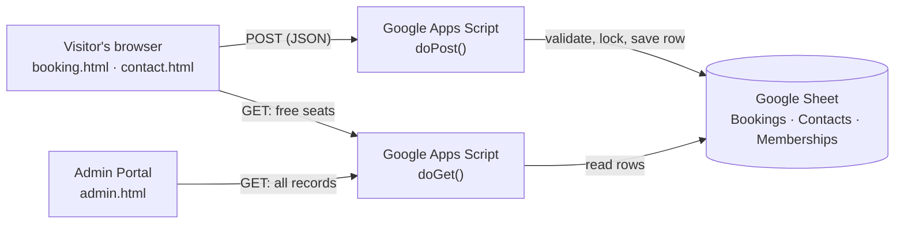

<div align="center">

# 📚 Library Hub

### Library Seat & Resource Booking System

**CSE326 Course Project · Lovely Professional University**

Book a reading seat, a group table or a discussion room online in under a minute.
Bookings and messages are saved straight into **Google Sheets**, and an **Admin Portal** shows them all in one place.<br>
Deployment link: https://sm01010011.github.io/Library_Hub_CSE326/


</div>

<p align="center">
  
</p>

---

## 📑 Table of contents

- [Project details](#-project-details)
- [Features](#-features)
- [Screenshots](#-screenshots)
- [Tech stack](#-tech-stack)
- [How it works](#-how-it-works)
- [Project structure](#-project-structure)
- [Getting started](#-getting-started)
- [Connect your Google Sheet](#-connect-your-google-sheet)
- [Deploy on Vercel](#-deploy-on-vercel)
- [Booking rules](#-booking-rules)
- [Concepts demonstrated](#-concepts-demonstrated)
- [Security notes](#-security-notes)
- [Author](#-author)

---

## 🎓 Project details

| | |
|---|---|
| **Course** | CSE326 |
| **University** | Lovely Professional University (LPU) |
| **Project title** | Library Hub: Library Seat & Resource Booking System |
| **Submitted by** | Swarit Mathur ([@SM01010011](https://github.com/SM01010011)) |
| **Type** | Course project: a website with a Google Sheets backend |

**Problem it solves:** finding a free seat in a busy college library means walking around and hoping. Library Hub lets a student check live seat availability, book a seat for a date and time slot, and get a booking ID, while library staff can see every booking, message and membership in one dashboard.

**Objective:** to build a complete, working website, from the pages and forms a visitor sees to the database behind them, using standard web technologies and a Google Sheet as a simple, free backend.

---

## ✨ Features

**For students and visitors**
- 🪑 **Live seat map**: 24 seats in a Silent zone (S1–S12) and a Group zone (G1–G12). Seats that are already taken for the chosen date and time slot show as booked.
- 🕘 **Four 2-hour slots a day**, with Sunday closed and shorter hours on Saturday.
- ✅ **Instant confirmation** with a booking ID to show at the help desk.
- 📨 **Contact form** for questions, feedback and problems.
- 🏷️ **Membership page** that explains the Student, Faculty and Guest plans.
- 📱 **Fully responsive** with a mobile hamburger menu, built with accessible, semantic HTML.

**For library staff**
- 🛠️ **Admin Portal** link in the top menu on every page.
- 📊 **Overview** counts for bookings, messages and memberships.
- 🔎 **Search and filter** bookings by name, registration number or date.
- 📥 **CSV export** for bookings, contact messages and memberships.
- 👀 **View-only** dashboard: the browser can read records but never edit or delete them.

**Safe by design**
- Every field is **validated twice**: in the browser and again on the server.
- **No double booking**: a script lock lets one request go first when two people book the same seat at the same moment.
- Values are saved as **plain text**, so something like `=1+1` can never run as a spreadsheet formula.
- Hidden **spam-trap** field, input length limits and HTML escaping in the dashboard.

---

## 🖼️ Screenshots

> The admin dashboard and the seat map below were captured with **sample data** (names like "Sample Student A" and `@example.com` emails). No real records are shown.

### Home
<p align="center">
  
</p>

### Book a seat
Pick a date and time slot, and the seat map shows which seats are free, booked, or your pick.
<p align="center">
  
</p>

### Booking confirmation
<p align="center">
  
</p>

### Spaces, Membership and Contact
<table>
  <tr>
    <td align="center" width="33%"><b>Spaces</b><br></td>
    <td align="center" width="33%"><b>Membership</b><br></td>
    <td align="center" width="33%"><b>Contact</b><br></td>
  </tr>
</table>

### About
<p align="center">
  
</p>

### Admin Portal (sample data)
<p align="center">
  
</p>
<table>
  <tr>
    <td align="center" width="50%"><b>Bookings</b><br></td>
    <td align="center" width="50%"><b>Messages</b><br></td>
  </tr>
</table>

### On a phone
<table>
  <tr>
    <td align="center" width="50%"><b>Home</b><br></td>
    <td align="center" width="50%"><b>Menu with Admin Portal</b><br></td>
  </tr>
</table>

---

## 🧰 Tech stack

| Part | What is used |
|------|--------------|
| Frontend | HTML5, CSS3, vanilla JavaScript (no frameworks, no build step) |
| Backend | Google Apps Script web app (`doGet` reads, `doPost` writes) |
| Database | Google Sheets (tabs: Bookings, Contacts, Memberships) |
| Hosting | Vercel (static site) |
| Fonts | Playfair Display and Poppins from Google Fonts |

---

## 🔄 How it works



- **Writing and reading are separate.** `POST` can only save a booking or a message, and `GET` can only read.
- The Sheet ID lives **only** inside `google-apps-script/Code.gs`, so the website code never sees it.
- The browser sends JSON as `text/plain`, which avoids the extra CORS "preflight" request that Apps Script cannot answer.

---

## 📁 Project structure

```
Library_Hub/
├── index.html              Home
├── about.html              About the library
├── spaces.html             Spaces and floor plan
├── booking.html            Booking form + seat map
├── membership.html         Membership plans
├── contact.html            Contact form
├── admin.html              Admin Portal (view-only dashboard)
├── css/
│   ├── style.css           Styles for all public pages
│   └── admin.css           Extra styles for the Admin Portal
├── js/
│   ├── config.js           ⚙️ The ONLY place the Apps Script URL is stored
│   ├── main.js             Shared helpers (menu, requests, error messages)
│   ├── booking.js          Booking form and seat map logic
│   ├── contact.js          Contact form logic
│   └── admin.js            Dashboard logic and CSV export
├── google-apps-script/
│   └── Code.gs             Backend. Pasted into Google Apps Script, not hosted
├── images/                 Photos and favicon
└── screenshots/            Images used in this README
```

---

## 🚀 Getting started

No installation is needed.

1. **Download or clone** the repository.
   ```bash
   git clone https://github.com/YOUR-USERNAME/Library_Hub.git
   cd Library_Hub
   ```
2. **Open the folder in VS Code** and run `index.html` with the **Live Server** extension (or double-click `index.html`).
3. The pages open straight away. To make bookings and the Admin Portal work, [connect a Google Sheet](#-connect-your-google-sheet). Until then, the forms show a clear "not connected" message and never pretend to succeed.

---

## 🔗 Connect your Google Sheet

**1. Create the sheet**
1. Go to [sheets.google.com](https://sheets.google.com) and open a **Blank spreadsheet**.
2. Name it **Library Hub Data**.
3. Copy the long **Sheet ID** from the address bar, the part between `/d/` and `/edit`.

**2. Add the backend code**
1. In the sheet, click **Extensions → Apps Script**.
2. Delete the sample code and paste in everything from `google-apps-script/Code.gs`.
3. Replace the placeholder in this line with your Sheet ID, then press **Ctrl+S**:
   ```js
   var SHEET_ID = 'PASTE_YOUR_GOOGLE_SHEET_ID_HERE';
   ```
4. Open **Project Settings** (gear icon) and set your **time zone** (for India: `Asia/Kolkata`). Dates and the "past date" check use it.

**3. Create the tabs**
1. In the toolbar, choose the function **`setupSheets`** and click **Run**.
2. Allow the permissions: **Review permissions → your account → Advanced → Go to project (unsafe) → Allow**. The warning is normal for your own script.
3. Your sheet now has the tabs **Bookings**, **Contacts** and **Memberships** with headings.

**4. Deploy as a Web app**
1. Click **Deploy → New deployment**, then the gear icon → **Web app**.
2. Set **Execute as: Me** and **Who has access: Anyone**.
3. Click **Deploy** and copy the **Web app URL** (it ends with `/exec`).

**5. Paste the URL into the website**

Open `js/config.js` and set:
```js
const SCRIPT_URL = "https://script.google.com/macros/s/XXXXXXXX/exec";
```

**6. Test it**
1. Open `booking.html` and make a booking. A new row appears in the **Bookings** tab.
2. Click **Admin Portal** in the top menu, then **Refresh**. Your booking shows up.

> **Changed `Code.gs` later?** The live script does not update by itself. Use **Deploy → Manage deployments → ✏️ → Version: New version → Deploy**. The URL stays the same.

**Memberships** are added by hand in the **Memberships** tab, one row per member. Membership Type must be exactly `Student`, `Faculty` or `Guest`, and dates are typed as `YYYY-MM-DD`.

---

## ▲ Deploy on Vercel

1. Push the project to a GitHub repository, with `index.html` at the top level.
2. On [vercel.com](https://vercel.com), click **Add New → Project** and import the repository.
3. Set **Framework Preset** to **Other** and leave the Build Command and Output Directory empty.
4. Click **Deploy**. After that, every `git push` redeploys the site automatically.

---

## 📏 Booking rules

| Rule | Value |
|------|-------|
| Seats | 24: **S1–S12** (silent zone) and **G1–G12** (group zone) |
| Time slots | 09:00–11:00, 11:00–13:00, 14:00–16:00, 16:00–18:00 |
| Registration number | Exactly 8 digits |
| Mobile number | 10 digits, starting with 6, 7, 8 or 9 |
| People per booking | 1 to 6 |
| Sunday | Closed |
| Saturday | Library closes at 17:00, so the 16:00–18:00 slot is not offered |
| Past dates | Not allowed |

---

## 🧠 Concepts demonstrated

| Area | What the project uses |
|------|-----------------------|
| **HTML5** | Semantic page structure (`header`, `nav`, `main`, `section`, `footer`), forms with labels, inputs, selects, radio buttons, checkboxes and textareas, a skip link, and an inline SVG floor plan |
| **CSS3** | Flexbox and CSS Grid layouts, CSS custom properties (variables) for the purple theme, media queries for phones and tablets, and a `prefers-reduced-motion` setting for users who dislike animation |
| **JavaScript** | DOM manipulation, event handling, form validation, building the seat map dynamically, `async` / `await` with the `fetch` API, and exporting records as a CSV file |
| **Accessibility** | ARIA attributes, a skip link, visible keyboard focus, and form error messages that screen readers announce |
| **Backend** | A Google Apps Script web app that handles `GET` and `POST` requests and returns JSON |
| **Database** | Google Sheets as the data store, with locking to prevent double bookings |
| **Validation and security** | Client-side and server-side validation, input sanitising, protection against spreadsheet formula injection, and a hidden spam-trap field |
| **Deployment** | Static hosting on Vercel with automatic redeploys from GitHub |

---

## 🔒 Security notes

This is an **academic project** for CSE326, not a production-secure system.

- The **Admin Portal has no login**. The Apps Script URL has to be public so the forms work, and it is visible in `js/config.js`. So anyone who finds the site can open `admin.html`, or call the URL with `?action=all`, and **read** names, emails, phone numbers and messages.
- The dashboard is view-only for writing: the browser cannot edit or delete anything, and `GET` requests cannot write.
- ➡️ **Use only test or dummy data.** Do not collect real students' details until proper protection is added.
- A real system would add a login (for example Google sign-in) and let only authorised accounts reach the admin endpoints.

---

## 👤 Author

**Swarit Mathur**
B.Tech Computer Science and Engineering, Lovely Professional University
GitHub: [@SM01010011](https://github.com/SM01010011)

Developed as part of the **CSE326** coursework at Lovely Professional University.

---

<div align="center">

If this project helped you, consider giving it a ⭐

</div>
